<div align="center">


# mDonator

**Aplikasi Android untuk operator pencatat sumbangan Yayasan Ibnu Atha'illah**

Kapuh Madani, Kandangan · Kalimantan Selatan

[](https://flutter.dev)
[](https://dart.dev)
[](#persyaratan)
[](API_CONTRACT.md)
[](#pengujian)
[](LICENSE)

</div>

---

mDonator adalah pendamping seluler aplikasi web **Donatur**, sistem pencatatan sumbangan Yayasan Ibnu Atha'illah. Operator mencatat sumbangan harian langsung dari HP: mengetik nomor donatur, memeriksa riwayatnya, lalu menyimpan nominal dengan ketukan sesedikit mungkin.

Semua aturan bisnis tetap di server dan sama dengan versi web: konfirmasi sumbangan ganda di hari yang sama, batas nominal yang perlu dikonfirmasi, hak mengubah input, dan atribut khusus admin. Aplikasi hanya menampilkan hasilnya lewat API JSON bertoken, sehingga web dan HP tidak pernah berbeda aturan.

> Nama repositori ini `mDonatur`; nama aplikasi dan paketnya `mDonator` (`com.kapuhmadani.mdonator`).

## Daftar isi

- [Fitur](#fitur)
- [Tangkapan layar](#tangkapan-layar)
- [Tampilan](#tampilan)
- [Arsitektur](#arsitektur)
- [Teknologi](#teknologi)
- [Struktur proyek](#struktur-proyek)
- [Memulai](#memulai)
- [Pengujian](#pengujian)
- [Dokumentasi](#dokumentasi)
- [Status proyek](#status-proyek)
- [Keamanan](#keamanan)
- [Lisensi](#lisensi)

## Fitur

| Fitur | Yang bisa dilakukan operator |
| --- | --- |
| **Masuk dan keluar** | Masuk sekali di awal hari kerja; sesi disimpan sebagai token di penyimpanan aman. Keluar meminta konfirmasi bila masih ada isian yang belum disimpan, lalu memberi tahu server (aksi `logout`) supaya keluarnya tercatat dan token itu dicabut. |
| **Pengaturan server** | Mengisi alamat server sendiri, termasuk instalasi di subfolder, sehingga aplikasi bisa dipakai di server mana pun. |
| **Cek dan cari donatur** | Melihat nama, alamat, bintang, dan riwayat sumbangan tahun ini setelah mengetik nomor; mencari donatur lewat nama, alamat, atau nomor bila nomornya lupa. |
| **Input sumbangan** | Mengisi nominal dari saran server atau tombol nominal cepat, menerima peringatan bila donatur sudah menyumbang hari ini atau nominalnya janggal, dan mengirim ulang dengan aman saat sinyal putus. |
| **Tambah donatur** | Mendaftarkan donatur baru beserta sumbangan pertamanya. Data yang persis sama dengan donatur terdaftar ditolak (beserta nomornya), dan sumbangan pertama di atas batas perlu dikonfirmasi. |
| **Input Saya** | Melihat semua input pada tanggal tertentu beserta totalnya untuk serah terima uang, dan memperbaiki nominal yang salah ketik sesuai hak ubah dari server. |
| **Rekap** | Melihat total harian, mingguan (Senin–Minggu), dan bulanan, milik sendiri maupun semua operator, lengkap dengan grafik per hari dan per operator. |
| **Ganti password** | Mengganti password langsung dari HP. |

Setiap fitur di atas bisa dilihat di [Tangkapan layar](#tangkapan-layar).

Direncanakan setelah MVP diterima: pindai QR kartu donatur, kirim bukti sumbangan lewat WhatsApp, dan versi iOS.

## Tangkapan layar

Diambil dari mDonator 1.1.0 di emulator Android 13 (Pixel 5) yang terhubung ke server lokal berisi **data demo fiktif**. Nama, alamat, dan nomor HP pada gambar bukan data donatur sungguhan.

### Masuk, pengaturan, dan keluar

<table>
<tr>
<td align="center" valign="top" width="33%">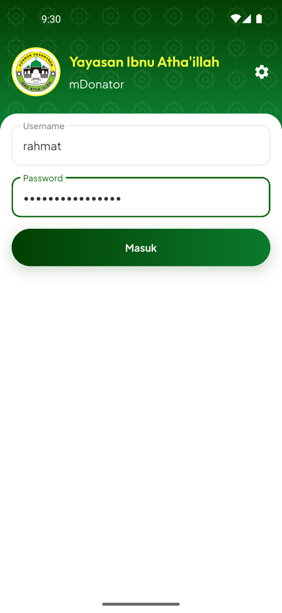<br><sub><b>Masuk.</b> Username dan password operator. Sesi disimpan sebagai token di penyimpanan aman, jadi cukup masuk sekali di awal hari kerja.</sub></td>
<td align="center" valign="top" width="33%">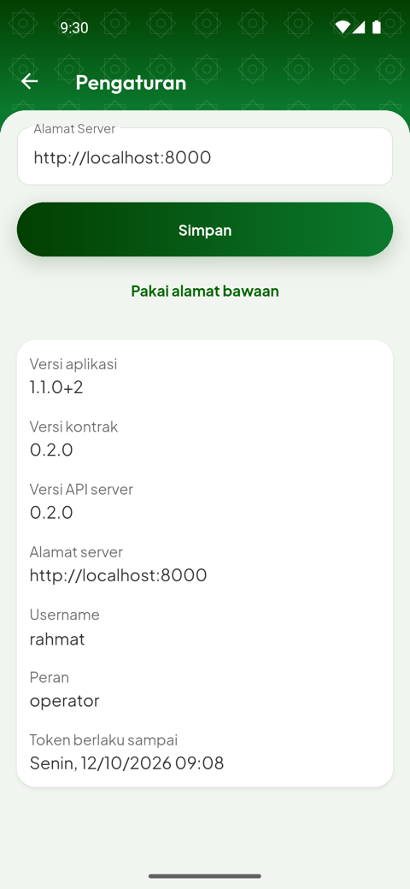<br><sub><b>Pengaturan.</b> Alamat server bisa diganti (juga instalasi di subfolder). Bagian bawah menampilkan versi aplikasi, kontrak, dan server, serta pengguna, peran, dan masa berlaku token.</sub></td>
<td align="center" valign="top" width="33%">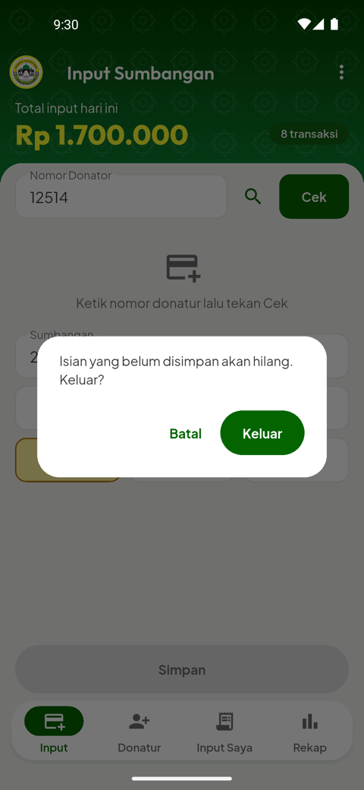<br><sub><b>Keluar.</b> Bila masih ada isian yang belum disimpan, aplikasi meminta konfirmasi. Setelah keluar, server diberi tahu lewat aksi <code>logout</code> sehingga keluarnya tercatat dan token dicabut.</sub></td>
</tr>
</table>

### Input sumbangan

<table>
<tr>
<td align="center" valign="top" width="33%">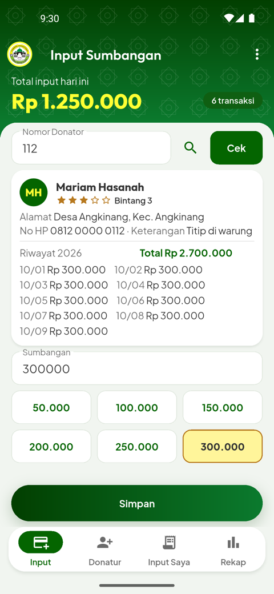<br><sub><b>Cek donatur.</b> Ketik nomor lalu Cek: nama, alamat, bintang (rata-rata sumbangan tahun lalu), dan riwayat tahun ini. Nominal saran dari server terisi otomatis dan tombolnya ditandai. Total input hari ini selalu tampil di kepala layar.</sub></td>
<td align="center" valign="top" width="33%">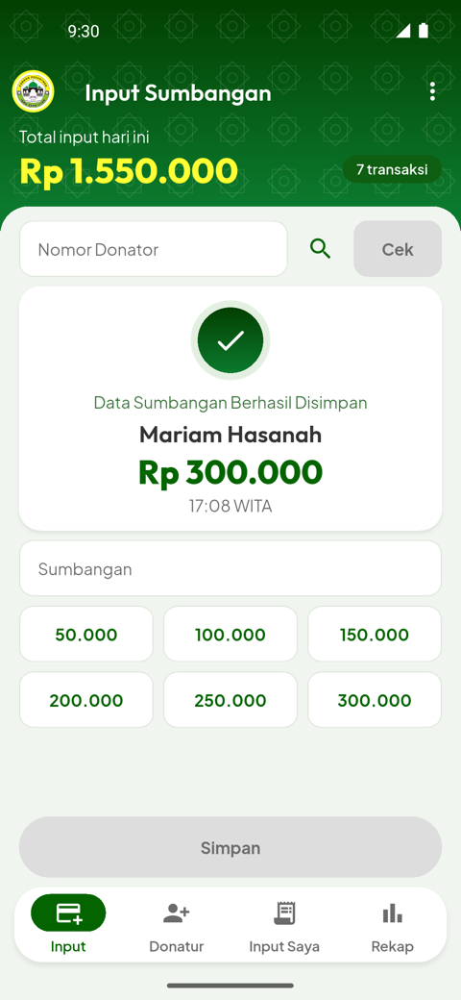<br><sub><b>Tersimpan.</b> Kartu hasil menampilkan nama, nominal, dan jam server (WITA), lalu total di kepala layar bertambah. Bila sinyal putus, Kirim ulang memakai kunci yang sama sehingga tidak ada input ganda.</sub></td>
<td align="center" valign="top" width="33%">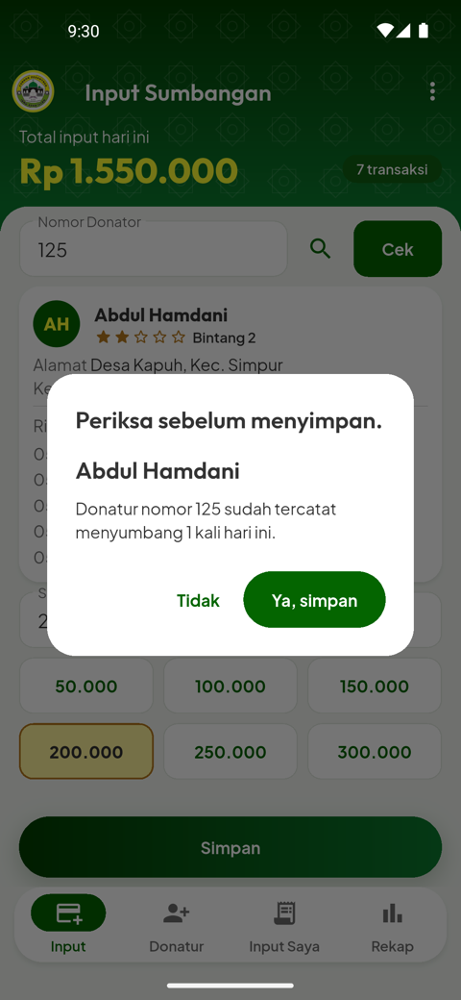<br><sub><b>Konfirmasi.</b> Server meminta konfirmasi bila donatur sudah menyumbang hari ini, atau bila nominalnya di atas batas. Ya, simpan mengirim ulang dengan konfirmasi; Tidak kembali ke isian.</sub></td>
</tr>
<tr>
<td align="center" valign="top" width="33%">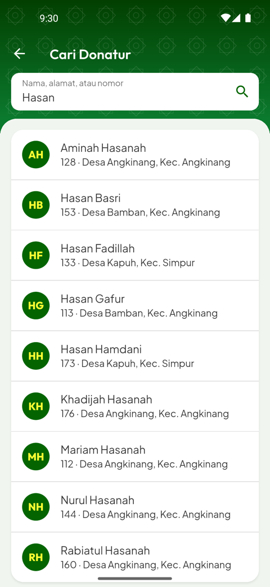<br><sub><b>Cari donatur.</b> Lupa nomornya? Cari lewat nama, alamat, atau nomor; ketuk hasilnya untuk langsung Cek di tab Input.</sub></td>
<td></td>
<td></td>
</tr>
</table>

### Tambah donatur

<table>
<tr>
<td align="center" valign="top" width="33%">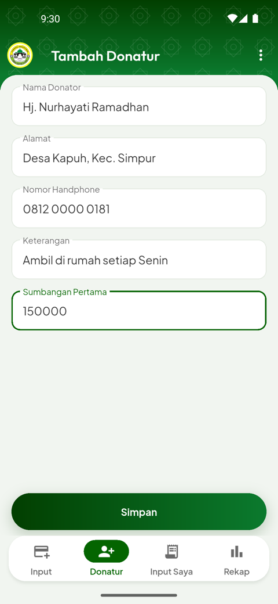<br><sub><b>Tambah donatur.</b> Nama, alamat, nomor HP, keterangan, dan sumbangan pertama. Server menolak data kembar dan meminta konfirmasi bila sumbangan pertamanya di atas batas.</sub></td>
<td align="center" valign="top" width="33%">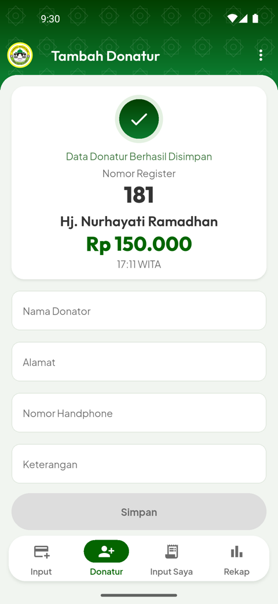<br><sub><b>Tersimpan.</b> Donatur dan sumbangan pertamanya tersimpan bersamaan, dan server memberi nomor register baru.</sub></td>
<td></td>
</tr>
</table>

### Input Saya

<table>
<tr>
<td align="center" valign="top" width="33%">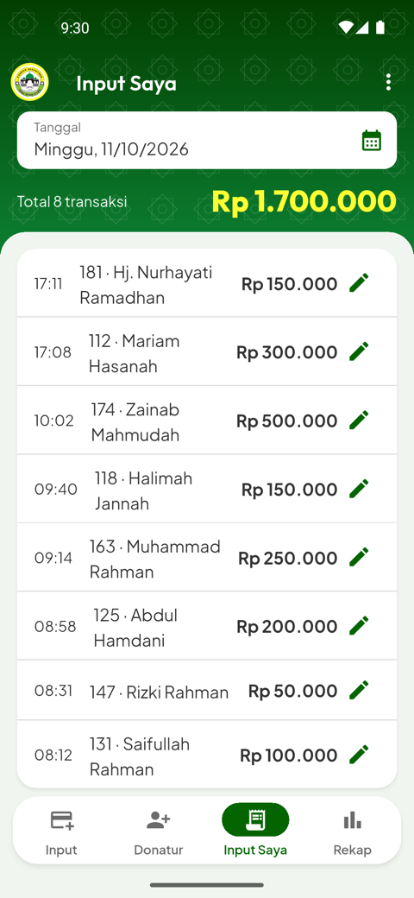<br><sub><b>Input Saya.</b> Semua input pada tanggal yang dipilih beserta jumlah transaksi dan totalnya, untuk serah terima uang di akhir hari.</sub></td>
<td align="center" valign="top" width="33%">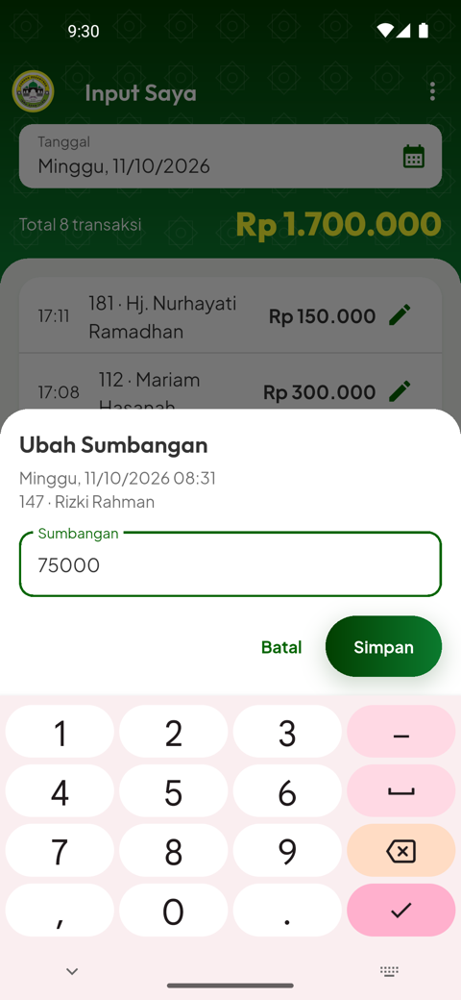<br><sub><b>Ubah sumbangan.</b> Memperbaiki nominal yang salah ketik. Hak ubah ditentukan server: operator hanya untuk inputnya sendiri pada hari ini.</sub></td>
<td></td>
</tr>
</table>

### Rekap

<table>
<tr>
<td align="center" valign="top" width="33%">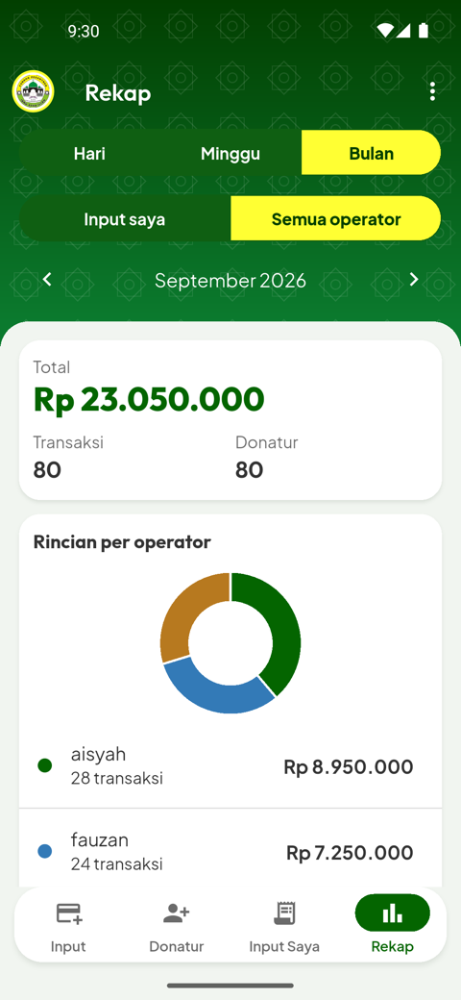<br><sub><b>Rekap.</b> Pilih Hari, Minggu (Senin–Minggu), atau Bulan, untuk input sendiri atau semua operator. Kartu ringkasan berisi total, transaksi, dan donatur, ditambah grafik donat per operator.</sub></td>
<td align="center" valign="top" width="33%">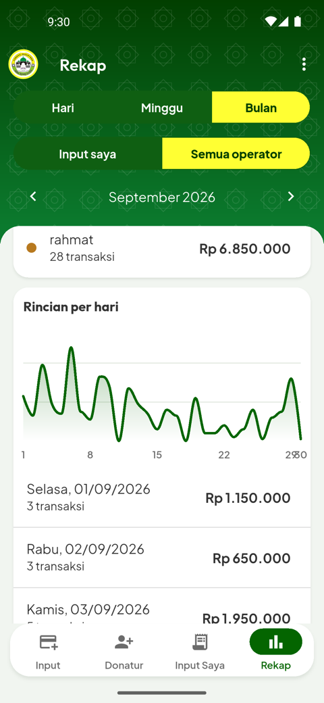<br><sub><b>Rincian per hari.</b> Grafik area per hari dan daftar total harian. Panah ← → berpindah ke periode sebelumnya atau berikutnya.</sub></td>
<td></td>
</tr>
</table>

### Ganti password

<table>
<tr>
<td align="center" valign="top" width="33%">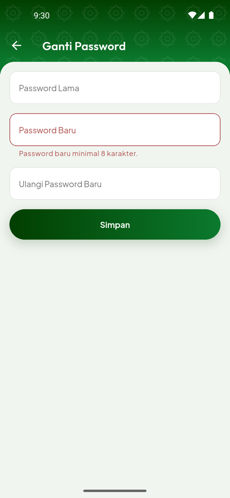<br><sub><b>Ganti password.</b> Validasi server tampil di bawah isian yang bermasalah, dan isian password dikosongkan setiap kali server menjawab. Setelah berhasil, token lama di semua perangkat batal.</sub></td>
<td></td>
<td></td>
</tr>
</table>

## Tampilan

Arah desain **"Dasbor Yayasan"** melanjutkan identitas hijau–kuning aplikasi web:

- kepala hijau bergradien dengan pola bintang delapan, angka penting berwarna kuning;
- isi layar di lembar hijau muda berkartu putih, dengan navigasi bawah yang mengambang;
- grafik area per hari dan donat per operator di tab Rekap;
- gerak singkat saat sumbangan tersimpan, yang mati bila pengaturan Android "Hapus animasi" aktif;
- huruf Plus Jakarta Sans dan Outfit yang dibundel di aplikasi.

Seluruh nilai visual (warna, huruf, jarak, bentuk, gradien, gerak) dikunci dalam satu tabel token di [`docs/26_UI_CONVENTIONS.md`](docs/26_UI_CONVENTIONS.md) dan hanya diimplementasikan di [`lib/tema.dart`](lib/tema.dart). Setiap pasangan teks dan latar memenuhi kontras WCAG AA, dan setiap layar layak di lebar 360 dp dengan skala huruf 1,3.

## Arsitektur

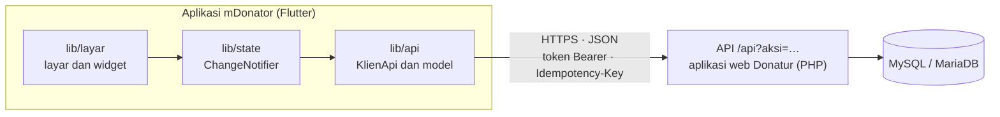

Prinsip yang dijaga di seluruh kode:

- **Aturan bisnis hanya di server.** Konfirmasi, hak ubah, bintang donatur, saran nominal, dan angka rekap dihitung server; aplikasi tidak menyalinnya.
- **Satu pintu ke jaringan.** HTTP hanya di `lib/api/klien_api.dart`, dan nama field JSON hanya di `lib/api/model.dart`. Keduanya mengikuti [`API_CONTRACT.md`](API_CONTRACT.md).
- **Aman dari sinyal lemah.** Setiap simpan membawa `Idempotency-Key`, sehingga "Kirim ulang" setelah koneksi putus tidak menggandakan data, dan isian tidak hilang saat galat.
- **Tidak ada data donatur di perangkat.** Yang disimpan hanya token, waktu kedaluwarsanya, alamat server, dan username terakhir, semuanya di penyimpanan aman Android.
- **Waktu dari server.** "Hari ini" selalu tanggal server (WITA), bukan jam HP.
- **State bawaan Flutter.** `ChangeNotifier` dan `InheritedNotifier`, tanpa paket state management atau router.

## Teknologi

| Lapisan | Pilihan |
| --- | --- |
| Kerangka | Flutter 3.47.5, Dart 3.13.4, Material 3 |
| Jaringan | [`http`](https://pub.dev/packages/http) |
| Penyimpanan aman | [`flutter_secure_storage`](https://pub.dev/packages/flutter_secure_storage) |
| Format dan lokal | [`intl`](https://pub.dev/packages/intl), `flutter_localizations` (id_ID) |
| Grafik | [`fl_chart`](https://pub.dev/packages/fl_chart) |
| Gerak | [`flutter_animate`](https://pub.dev/packages/flutter_animate) |
| Kerangka memuat | [`skeletonizer`](https://pub.dev/packages/skeletonizer) |
| Huruf | Plus Jakarta Sans dan Outfit (SIL OFL 1.1), dibundel |

Dependensi sengaja dibuat sedikit; paket baru hanya masuk lewat persetujuan pemilik ([`docs/09_STACK.md`](docs/09_STACK.md)).

## Struktur proyek

```text
lib/
├── main.dart          aplikasi, lokal id_ID, orientasi potret
├── tema.dart          token desain: satu-satunya tempat warna, huruf, jarak, gradien, gerak
├── api/               klien API, model JSON, jenis galat
├── state/             Sesi dan satu ChangeNotifier per layar
├── layar/             Masuk, kerangka 4 tab, Input Sumbangan, Cari, Tambah Donatur,
│                      Input Saya, Ubah Sumbangan, Rekap, Ganti Password, Pengaturan
├── widget/            komponen bersama: kartu, latar dasbor, grafik, tombol utama, …
└── util/              format rupiah dan tanggal, kunci idempotensi
test/                  uji unit, klien API, kepatuhan kontrak, dan widget
assets/                logo yayasan dan berkas huruf
docs/                  blueprint 00–27: PRD, scope, arsitektur, keamanan, konvensi UI, kriteria terima
screenshots/           tangkapan layar untuk README (data demo fiktif)
API_CONTRACT.md        kontrak API (aksi, payload, kode galat)
```

## Memulai

### Persyaratan

- Flutter 3.47.5 (Dart 3.13.4), Android SDK, dan JDK 17
- Emulator atau HP Android 7.0 (API 24) ke atas
- Server aplikasi web Donatur dengan API mobile aktif. Server berada di repositori terpisah dan tidak termasuk di sini.

### Menjalankan

```bash
flutter pub get

# Emulator Android dengan server di komputer yang sama (port 8000)
adb reverse tcp:8000 tcp:8000
flutter run --dart-define=SERVER_URL=http://localhost:8000
```

Alamat server bawaan berasal dari `--dart-define=SERVER_URL` dan bisa diganti kapan saja di layar Pengaturan. Build debug menerima `http://` untuk server lokal; build rilis hanya menerima `https://`.

### Membangun APK

```bash
flutter build apk --debug --dart-define=SERVER_URL=https://alamat-server-anda
```

Hasilnya ada di `build/app/outputs/flutter-apk/app-debug.apk`.

## Pengujian

```bash
flutter analyze   # No issues found!
flutter test      # All tests passed! (291 uji)
```

Uji berjalan tanpa jaringan, memakai `MockClient` sebagai server tiruan:

- **Unit:** format rupiah dan tanggal, serta klien API terhadap seluruh katalog galat kontrak (401, 409, 422, putus koneksi, versi tidak cocok, kirim ulang dengan kunci yang sama).
- **Kepatuhan kontrak:** setiap contoh JSON di `API_CONTRACT.md` harus terbaca oleh model, sehingga perubahan kontrak memaksa kode ikut berubah.
- **Widget:** empat state (kosong, memuat, gagal, sukses) di setiap layar, dialog konfirmasi, hak ubah, dan tata letak 360×640 dp dengan skala huruf 1,3 tanpa luapan.
- **Tata letak dan gerak:** layar Input Sumbangan muat tanpa digulir di Pixel 5 dengan huruf aplikasi, dan gerak diuji dengan serta tanpa "Hapus animasi".

Uji integrasi opsional terhadap server lokal dijelaskan di [`docs/11_COMMANDS.md`](docs/11_COMMANDS.md) dan [`docs/13_TESTING.md`](docs/13_TESTING.md).

## Dokumentasi

| Dokumen | Isi |
| --- | --- |
| [`API_CONTRACT.md`](API_CONTRACT.md) | Kontrak API: aksi, payload, kode galat, dan aturan versi. Rujukan tertinggi untuk semua yang menyangkut API. |
| [`docs/`](docs/) | Blueprint 00–27: PRD, scope, roadmap, model domain, proses bisnis, arsitektur, aturan keamanan, konvensi UI, dan kriteria terima per fitur. |
| [`CLAUDE.md`](CLAUDE.md) dan [`INDEX.md`](INDEX.md) | Panduan kerja untuk agen AI; proyek ini dibangun slice demi slice dari blueprint dengan metode VCBD. |
| [`DOSIR_MDONATOR.md`](DOSIR_MDONATOR.md) | Bahan asal blueprint. Bila berbeda dengan `docs/`, yang berlaku `docs/`. |

## Status proyek

Dalam pengembangan. Slice S0–S7 selesai ([`docs/03_ROADMAP.md`](docs/03_ROADMAP.md)): dasar proyek dan klien API, masuk dan pengaturan, input sumbangan, tambah donatur, Input Saya, rekap, ganti password, dan desain "Dasbor Yayasan". Versi 1.1.0 (kontrak API 0.2.0) menambahkan pemberitahuan keluar ke server (aksi `logout`). Slice S8 (kontrak API 0.3.0) memberi admin centang Note di Input Sumbangan dan tombol hapus di Input Saya; dirilis sebagai 1.2.0+3 (server 2.4.0), belum dideploy ke produksi. Distribusi aplikasi ke HP operator belum dimulai.

## Keamanan

- Jangan mencantumkan alamat server, token, password, atau data donatur di issue maupun pull request.
- Bila menemukan celah keamanan, hubungi pemilik repositori secara langsung, bukan lewat issue publik.
- Aturan keamanan aplikasi (penyimpanan token, transport, log) ada di [`docs/21_SECURITY_RULES.md`](docs/21_SECURITY_RULES.md).

## Lisensi

- **Kode:** [MIT](LICENSE) © 2026 Syamsuddin, S.Pd.
- **Huruf:** Plus Jakarta Sans dan Outfit berlisensi SIL Open Font License 1.1 ([`assets/huruf/`](assets/huruf/)).
- **Logo:** logo Yayasan Ibnu Atha'illah adalah identitas yayasan; penggunaannya di luar aplikasi ini memerlukan izin yayasan.
